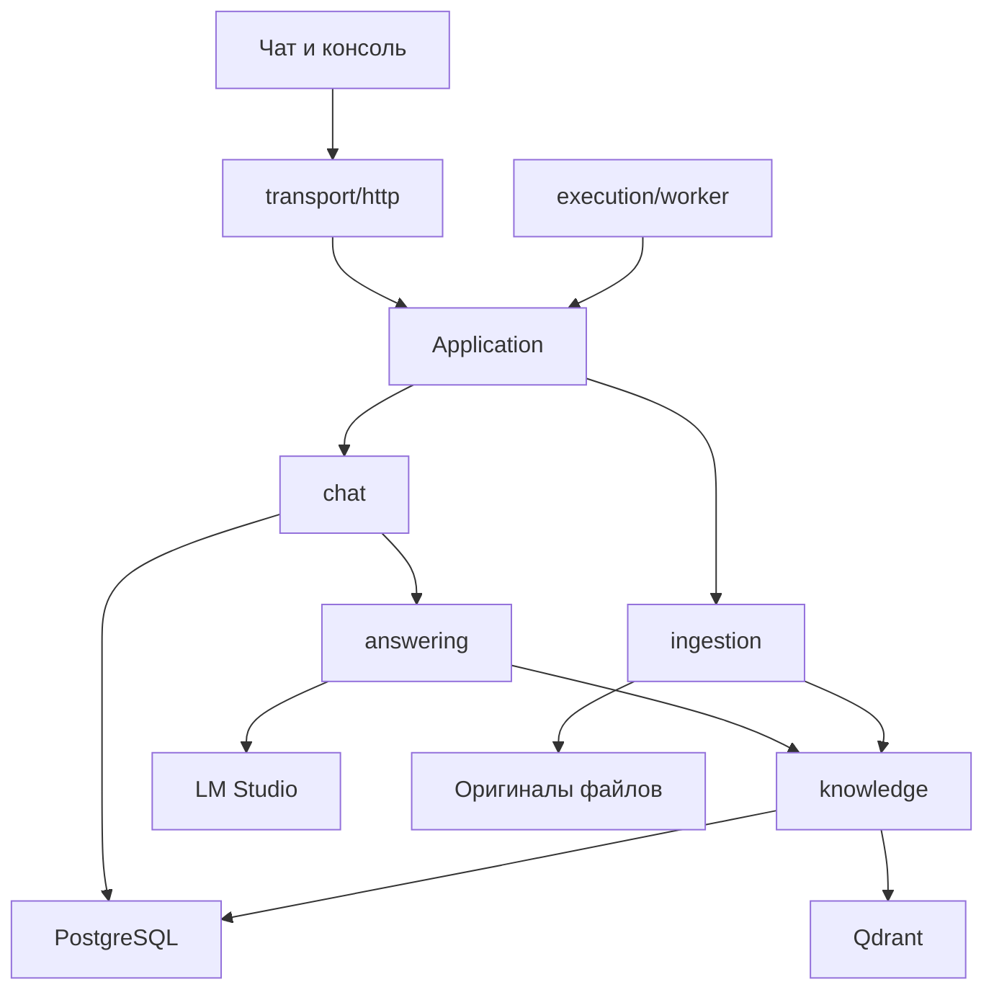

# Архитектура AgentAI

Обновлено 21 октября 2026 года. Реализован вариант Б из
[плана перестройки](architecture-plan.md): модульный монолит с общими сценариями
для HTTP и фонового исполнения. Существующий ASGI-адрес `agentai.api:app`,
маршруты, статические сайты и форматы ответов сохранены.

## Карта кода

| Модуль | Ответственность |
| --- | --- |
| `api.py` | Точка входа ASGI и совместимость существующих интеграций |
| `bootstrap.py`, `settings.py` | Сборка внешних зависимостей и настройки моделей |
| `application.py`, `commands.py` | Общие операции и входные контракты |
| `transport/http/` | Маршруты по возможностям, HTTP-ошибки и запуск worker |
| `access/` | Проверка ключей, ролей и разрешённых источников |
| `chat/` | Сценарий вопроса, ограничение истории и её хранение |
| `answering/` | LangGraph, состояние доказательств одного запроса, ссылки и проверка ответа |
| `ingestion/` | Сохранение загрузки, извлечение текста и подготовка версии к индексации |
| `knowledge/` | Гибридный поиск, область поиска, соседи, кеш и публикация поколений |
| `execution/` | Очередь PostgreSQL, диспетчер, worker и общий лимит GPU |
| `adapters/` | PostgreSQL, файловый архив, LM Studio, GitLab и метаданные SQL Server |
| `migrations.py` | Версионированная схема PostgreSQL |

Старые пути `core`, `agent`, `database`, `jobs`, `documents`, `indexing` и ряд
вспомогательных модулей оставлены как небольшие модули совместимости. Новый код
импортирует реализации из модулей-владельцев. Прямые вызовы истории и очереди
теперь возвращают `ApplicationError`; HTTP преобразует его в прежний JSON
с полем `detail` и соответствующим статусом.



`Application` получает поставщиков зависимостей. Поэтому тест или другой
способ запуска может передать собственные хранилища и модели, не меняя сценарии.
Модули сценариев, поиска и адаптеров не импортируют FastAPI. Сборка HTTP-приложения
сама по себе не подключается к БД и не загружает модели.

## Подготовка ответа

`chat/service.py` проверяет права, получает допустимую историю и вызывает
движок ответа. Видимость ссылок из истории проверяется адресно по идентификаторам
фрагментов и текущим поколениям индекса.

`AnswerSession` хранит доказательства, стабильные метки S1/S2, область поиска,
приоритет дочитывания и контекст только одного запроса. Повторный пустой поиск
не стирает ранее найденные доказательства. Сборка окончательного результата
выделена в `answering/result.py`: она проверяет текст и ссылки без нового
вызова модели. Сам граф LangGraph и ограничения шагов сохранены.

Память диалога остаётся в PostgreSQL. Состояние графа между запросами не
сохраняется через checkpointer: новый граф получает разрешённую историю из БД.
Прежние ограничения объёма истории и однократного исправления ответа сохранены.

## Исполнение и восстановление

Все прежние маршруты с GPU-операциями и worker используют `Capacity`.
В одном процессе он ограничивает потоки семафором; при настроенной PostgreSQL
дополнительно удерживает session advisory lock с ключом 72900434.
Другой экземпляр получает занятость, а недоступная координация возвращает 503.
Лидерство очереди сохраняет отдельную блокировку 72900432.

Для чат-задания запись хода диалога и сохранение результата со статусом
`succeeded` выполняются в одной транзакции. Завершённый результат больше не
перезаписывается последующей ошибкой `Worker.finish`. Повторная диспетчеризация
завершённого задания возвращает сохранённый результат без нового вызова модели.
Перед этим снова проверяются роль пользователя и доступность результата.

Это не обещание единственного вызова модели при любом сбое: падение до
транзакции может привести к повторной генерации. Гарантия относится к сохранению
хода диалога и результата задания. Отмена выполняющейся генерации не добавлена.
Блокировка GPU координирует сотрудничающие процессы; вызовы LM Studio из других
программ её не учитывают. При потере соединения PostgreSQL session lock теряется,
а уже начатый запрос модели автоматически не прерывается.

## Каталог и поколения индекса

Конструктор `Database` больше не выполняет SQL. Схема создаётся через
`Database.migrate()`, под транзакционной блокировкой, с учётом выполненных версий
в `schema_versions`. Bootstrap вызывает миграцию при получении БД и на старте
приложения. Повторный запуск сохраняет существующие записи.

Если сторонний скрипт создаёт `Database` напрямую для пустой БД, он должен
явно вызвать `migrate()`. Скрипт переноса старого каталога обновлён.
SQLite остаётся явно обозначенным режимом совместимости архива и автономных
проверок; рабочий режим использует PostgreSQL.

`knowledge/publication.py` записывает все векторы нового поколения в Qdrant
до переключения указателя. Указатель и состояние версии изменяются в одной
транзакции PostgreSQL. Частичное поколение не становится видимым.
При удалении версии её статус `removed` и отключение поколения также меняются
атомарно. Попытка удалить уже заменённую версию откатывает изменение указателя.
Повтор завершённого удаления допускается и сохраняет оригинал.

Автоматическая очистка старых векторов и оригиналов не добавлена. Резервная
копия по-прежнему должна согласованно охватывать PostgreSQL, Qdrant и оригиналы.

## Поиск и кеш

Кеш корпуса ограничен четырьмя записями и 30 секундами. Его ключ включает
набор разрешённых источников и их активные поколения. Перед использованием
проверяются указатели PostgreSQL; метаданные актуальности читаются заново.
Публикация и удаление через этот экземпляр очищают его кеш. Вызывающий код
получает копию данных, поэтому не может испортить общий снимок.

BM25 повторно используется для идентичного набора фрагментов и текстов;
изменение области поиска или поколения приводит к другому набору.
Соседи версионного документа запрашиваются по его идентификатору и версии.
Для прежних фрагментов кода без таких полей сохраняется поиск соседей по корпусу.
Прямые изменения Qdrant в обход публикации могут быть видны с задержкой до TTL.

Полный корпус всё ещё нужен для построения лексического индекса и обработки
некоторых запросов. Это оптимизация существующего алгоритма; поиск по большим
корпусам ещё требует отдельных нагрузочных измерений.

## Проверка изменений

- До изменений: **108 тестов**, отдельная PostgreSQL.
- После изменений: **121 тест**, включая сбой до и после записи ответа,
  повтор миграций, изоляцию приложений, общий лимит GPU, обновление кеша при
  смене поколения/актуальности и откат удаления старой версии.
- Автономный режим без PostgreSQL: **97 тестов прошли, 24 пропущены** как
  требующие отдельной PostgreSQL; совместимость SQLite сохранена.
- Статическая проверка всех 63 Python-модулей приложения: циклов импортов и
  зависимостей внутренних модулей от HTTP не найдено.
- На 30 синтетических вопросах с реальной Nomic embeddings порядок результатов
  совпал с исходной реализацией во всех случаях; Recall@3 и MRR@6 равны 1,0
  для обеих реализаций на этом наборе. Использовались одинаковые векторы.
- Живой сценарий с Qwen3-4B: загрузка учебного документа → очередь → ответ
  с правильным числом 17 → подтверждённая ссылка → один ход истории. Проверка
  ответа прошла за один шаг. Рабочий индекс не использовался.
- Собран отдельный Docker-образ `agentai-architecture-check`; проверены
  `/health`, консоль, статические файлы и обязательность авторизации.

Сравнение прогретого поиска в Qdrant в памяти, с одинаковыми детерминированными
векторами; медиана шести повторов после трёх прогревочных запросов:

| Фрагментов | До, мс | После, мс |
| ---: | ---: | ---: |
| 100 | 8,36 | 6,12 |
| 1000 | 185,04 | 89,17 |
| 5000 | 2716,76 | 1542,49 |

Число вызовов scroll за девять запросов на 5000 фрагментов снизилось со 180 до 20.
В эти времена не входит генерация модели или сетевые задержки рабочего Qdrant.
Они не описывают общую задержку ответа пользователю.

Отчёты конкретного запуска находятся в локальных, исключённых из Git файлах
`work/architecture-final.xml`, `work/architecture-search-comparison.json`,
`work/architecture-real-search.json` и `work/architecture-live-answer.json`.

Для повторной проверки:

```powershell
.venv\Scripts\python.exe scripts/verify_static.py
.venv\Scripts\python.exe scripts/architecture_check.py
.venv\Scripts\python.exe scripts/test.py
```

Для PostgreSQL-проверок перед запуском задаётся `TEST_DATABASE_URL` отдельной
тестовой БД. Тесты создают и удаляют только свои схемы. Без этой переменной
PostgreSQL-сценарии пропускаются.

## Применение к работающему сервису

На этапе перестройки был собран отдельный проверочный образ. Позднее, 21 октября
2026 года, новая архитектура и настройки применены к работающему API после
резервного копирования и проверки восстановления. Результаты — в
[отчёте настройки и оптимизации](runtime-tuning.md). Обычное последующее обновление
выполняется через `docker compose up -d --build api` после согласованной резервной копии.
Для изменения схемы на старте требуется роль БД, имеющая соответствующие права.
Новая таблица учёта миграций добавляется без удаления существующих таблиц.
